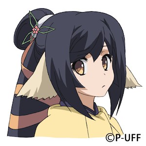

<!--
  首页正文：每个 <section class="zh-card"> 是一张卡片，文字可直接修改。
  横幅（名字、副标题）在 docs/overrides/partials/zh-banner.html；
  左侧个人卡在 docs/overrides/partials/zh-profile.html。
-->

<section class="zh-card zh-reveal" id="welcome" markdown="0">
  
Welcome ようこそ

  <h2 class="zh-title">Research Interests</h2>
  
I'm passionate about understanding the brain through computational approaches, with a main focus on NeuroAI and a growing interest in brain–computer interfaces.

  <ul class="zh-tags">
    <li>NeuroAI</li>
    <li>Machine Learning</li>
    <li>Computational Neuroscience</li>
    <li>Brain–Computer Interfaces</li>
  </ul>
</section>

<section class="zh-card zh-reveal" id="ongoing" markdown="0">
  

  

  <h2 class="zh-title">Ongoing Research</h2>
  

    <article class="zh-project__entry">
      <h3 class="zh-project__name">Whole-Brain fMRI Decoding of Subjective Food Value: Cross-Participant Generalization and Spatial Attribution</h3>
      <a class="zh-link" href="https://github.com/BoneWise/food-decoding-fmri" target="_blank" rel="noopener noreferrer">Code, results and manuscript →</a>
    </article>
    <article class="zh-project__entry">
      <h3 class="zh-project__name">Food Representations in Vision and Vision–Language Models</h3>
      <a class="zh-link" href="https://github.com/BoneWise/foodLLM" target="_blank" rel="noopener noreferrer">Results and methods →</a>
    </article>
  

  

  

    

      
    

    

      
    

    <canvas class="zh-voxels"></canvas>
  

  

</section>

<section class="zh-card zh-notes zh-reveal" id="notes" markdown="0">
  <h2 class="zh-title">Learning Journey</h2>
  <a class="zh-notes__link" href="https://www.notion.so/210b53648e9180d9816df03c3f8055f7?v=210b53648e9180d19a9d000ca3071a3f&source=copy_link" target="_blank" rel="noopener noreferrer">
    
      <svg viewBox="0 0 24 24"><path d="M12 6.5C10 5 7.5 4.5 4 4.5v13c3.5 0 6 .5 8 2 2-1.5 4.5-2 8-2v-13c-3.5 0-6 .5-8 2z"/><path d="M12 6.5v13"/></svg>
    
    
      <strong>My Reading Notes on Notion</strong>
      <small>Explore my notes on research papers, books, and learning materials.</small>
    
    →
  </a>
</section>
